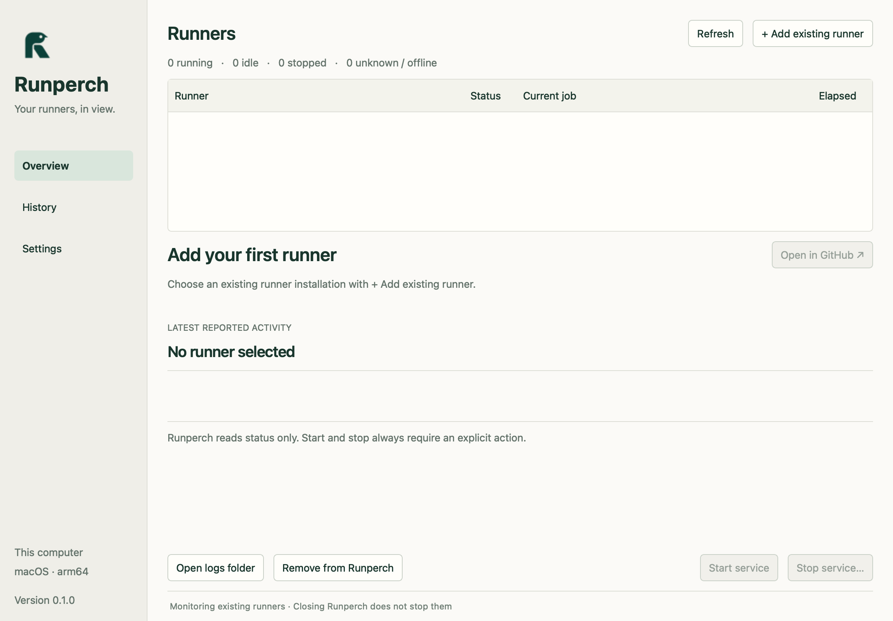
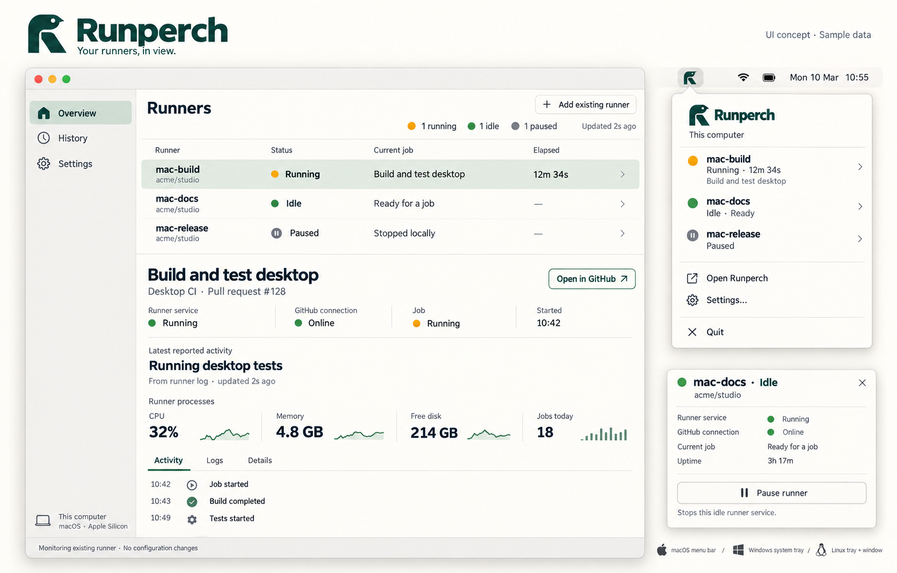

<p align="center"></p>

<h1 align="center">Runperch</h1>

<p align="center"><strong>Your runners, in view.</strong></p>

<p align="center">
  <a href="https://github.com/FabioLissi/runperch/actions/workflows/ci.yml"></a>
  &nbsp; <a href="LICENSE">Apache 2.0</a>
  &nbsp; · &nbsp; <a href="#screenshots">Screenshots</a>
  &nbsp; · &nbsp; <a href="#build-and-run">Build and run</a>
</p>

Runperch is a small desktop monitor for existing GitHub Actions self-hosted
runners. Attach a configured runner, see its local service and GitHub job state,
and open the current job without hunting through terminals.

## Features

- **Runner overview:** one row per installation, details for the selected runner.
- **Current work:** workflow, job, reported step, elapsed time and GitHub link.
- **Resource observations:** process-tree CPU, aggregate RSS and free disk.
- **Menu bar / tray:** see runner states and open the main window quickly.
- **Local history:** a bounded list of jobs observed while Runperch runs.
- **Connect GitHub:** browser/device sign-in through GitHub CLI, with account identity and no token copying.
- **Recent results:** latest matched completed jobs and their server-reported outcomes.
- **Explicit controls:** start the existing service; stop requires fresh idle
  evidence, confirmation and another status check.
- **JSON CLI:** the same monitor, validation and policy for scripts.
- **Honest status:** unknown or expired evidence stays Unknown. No invented
  completion percentages or finish-current-job guarantees.

## Screenshots

Click a thumbnail to see the full image.

<table>
  <tr>
    <td width="50%" align="center">
      <a href="assets/screenshots/macos-first-launch.png"></a>
      <br><strong>macOS app · first launch</strong><br>
      Actual application capture from version 0.1.0.
    </td>
    <td width="50%" align="center">
      <a href="assets/ui-concept.png"></a>
      <br><strong>Interface design concept</strong><br>
      Sample data and intended visual direction.
    </td>
  </tr>
</table>

The current app implements the table, details, metrics, history, settings and
tray menu. The concept's sparklines and compact runner-detail popover are not
implemented in this first version. Public screenshots contain no personal
runner configuration or credentials.

## Status

macOS is the first native adapter. The core, GitHub adapter, UI and CLI are
platform independent. Windows/Linux currently build with an explicit unsupported
native-service adapter; native service controls are **not implemented** there.

| Platform | Shared app and CLI | Native service integration |
|---|---|---|
| macOS | Built and tested locally | Existing user LaunchAgents through launchd |
| Windows | Included in the CI build matrix | Not implemented yet |
| Linux | Included in the CI build matrix | Not implemented yet |

Runperch does not install/register runners, move working directories, modify
LaunchAgents, change signing/keychain sessions, upload logs or collect telemetry.
It never reads the runner's `.credentials` files.

## Build and run

Requires C++20, CMake 3.24+, and the open-source Qt 6.5+ Core/Gui/Widgets/Test
modules. GitHub observations use the official `gh` CLI and its existing login.

Clone the public repository:

```sh
git clone https://github.com/FabioLissi/runperch.git
cd runperch
```

With the dependencies installed:

```sh
cmake -S . -B build -DCMAKE_BUILD_TYPE=Release
cmake --build build --parallel
ctest --test-dir build --output-on-failure
```

On macOS, install Qt with `brew install qtbase` and, if CMake needs it, add
`-DCMAKE_PREFIX_PATH="$(brew --prefix qtbase)"` to configuration. Use
`brew install gh` for GitHub access. Use **Connect GitHub** in the app or
`gh auth login` in Terminal. This builds a development
app, not a self-contained signed/notarized distribution.

```sh
open build/runperch.app
build/runperchctl --runner /path/to/actions-runner --local-only
build/runperchctl --runner /path/to/actions-runner
```

Use **Add existing runner** to select a configured installation. macOS suggests
top-level `~/actions-runner*` directories on first launch, asking before saving
them. Other locations are supported through the folder picker or `--runner`.
Normal monitoring uses local service observations and readable GitHub job APIs;
it does not request runner-administration access. Active runs and recent
completed runs are inspected independently, each bounded to three workflows
and the first 100 jobs per workflow. Jobs must match runner ID and name.
No match is **Unknown**, never proof that the runner is idle.

The runner-management status endpoint is optional, disabled by default, and
available through Settings or CLI `--runner-status`. It needs additional role
and token permissions. Organization-scoped registrations have no repository
for job lookup, so their default view provides local service observations.
Enterprise hosts are not supported yet.

Browser authorization uses GitHub CLI's standard repo/read:org/gist OAuth scopes;
these are distinct from repository administrator roles. Signing in can change
the active gh account shared with other applications. GitHub CLI normally uses
OS secure storage, but may fall back to its own plaintext configuration when
secure storage is unavailable. Runperch does not receive or persist the token.

### CLI examples

```sh
# Discover platform-suggested installations.
build/runperchctl --discover

# Monitor several installations in one read-only invocation.
build/runperchctl --runner /path/to/runner-one --runner /path/to/runner-two
```

JSON includes observation timestamps and only the metrics available. A
successful query is not a health verdict: inspect the returned states.

## Controls and status

- Service, GitHub connection and job state are separate observations.
- Expired observations are unknown; process existence does not prove online.
- Start/stop use the existing user LaunchAgent, with identity checked again.
- Stop is enabled only after a fresh GitHub Idle observation, requires explicit
  confirmation and rechecks status. A new job can race the check: this is
  **service stop**, not guaranteed finish-current-job draining.
- With runner-management checks disabled, stop remains unavailable because
  absence of an active job is insufficient idle evidence. No admin access is
  required merely to monitor the service, metrics or readable job activity.
- No controls automatically run when the app launches, closes or refreshes.
- On macOS, the red close button leaves Runperch in the menu bar and hides its
  Dock icon. Choose **Open Runperch** in the menu-bar menu to restore both the
  window and Dock icon. Disable **Hide from Dock when the window is closed** in
  Settings if you prefer to keep the Dock icon.
- Without an available tray, closing the window exits the monitor normally.
  **Quit Runperch** always closes the monitor and leaves runners untouched.
- CPU is process-tree core equivalents; RSS is a sum, including shared pages.
- History contains only jobs observed by this app, not the complete GitHub audit.

Settings and observed-job history use Qt's per-user application settings. Raw
runner logs, subprocess stderr, tokens and credentials are not persisted.
History retains at most 200 observed jobs. **Open logs folder** opens the local
runner diagnostics directory; Runperch does not upload its contents.

## Development

See [architecture and reference conformance](design/architecture.md).
The UI and CLI share the same monitor, validation and control policy. OS calls
belong exclusively behind `src/platform/platform.h`. New native adapters must
pass shared contracts plus real service integration checks on their own OS.
Never exercise stop/start tests against someone else's active runner.

`runperch --screenshot /path/window.png --runner /path/runner` captures only the
app's own window after its first observation and exits, for UI smoke checks.

Screenshot mode uses isolated settings. Public images should use an empty
first-launch state or sample configuration; inspect images for account names,
local paths and job details before publishing them.

## License

Runperch is [Apache-2.0](LICENSE). See [NOTICE](NOTICE) and
[third-party notices](THIRD_PARTY_NOTICES.md). Qt retains its own licenses;
Runperch uses the open-source/community build with dynamic linking. No upstream
runner-manager source code is included.
